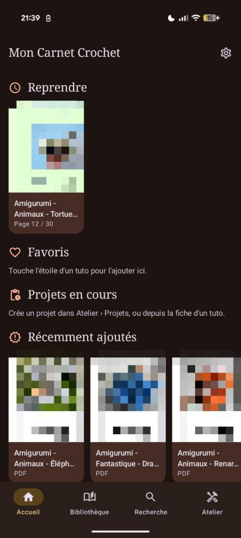
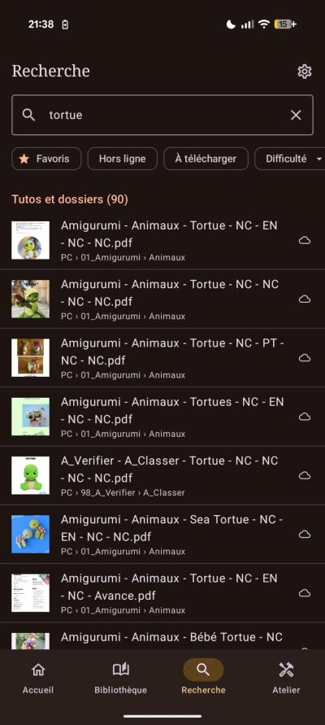
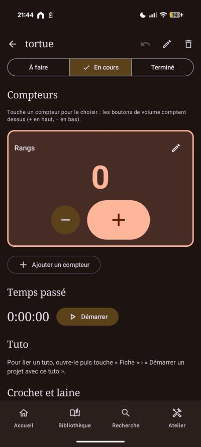
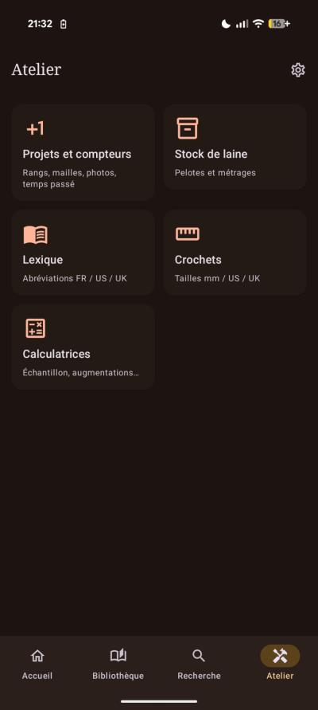

# 🧶 Mon Carnet Crochet

**L'appli Android pour lire tes tutos de crochet et suivre tes ouvrages, rang après rang.**

Tes tutos (PDF, images, vidéos, textes) au même endroit, qu'ils soient sur le téléphone ou sur ton PC, avec un compteur de rangs, des notes et ton stock de laine.

### [⬇️ Télécharger la dernière version](https://github.com/Loroche974/crochetatelier-releases/releases/latest)

Gratuite, sans compte et sans publicité. Android 8.0 ou plus récent, sur téléphone et tablette.

  
  
  
  
  

---

## Ce que fait l'appli

### 📚 Tous tes tutos au même endroit
- PDF, images, vidéos et fiches texte.
- Depuis un dossier du téléphone et/ou **directement depuis le PC de la maison** par le Wi-Fi, sans rien copier.
- Vues grille, liste, cartes ou compacte, avec miniatures.
- Recherche par nom, **dans le texte des PDF**, dans tes notes ou tes étiquettes.

### 📖 Un lecteur pensé pour le crochet
- Reprend chaque tuto **à la dernière page lue**.
- **Annotations** : stylo, surligneur, texte. Le fichier d'origine n'est jamais modifié.
- Marque-pages, niveau de difficulté, étiquettes et notes avec cases à cocher.

### 🔢 Suivre un ouvrage
- **Compteur de rangs** affiché par-dessus le tuto, qu'on avance aussi avec les **boutons de volume**.
- **Règle de lecture** qui descend d'une ligne à chaque rang.
- **Mode mains libres** : dis « suivant » ou « précédent », les mains restent sur le crochet.

### 🧰 L'atelier
- Projets en cours.
- Stock de laine.
- Lexique des points **FR ↔ US ↔ UK**.
- Tailles de crochets.
- Calculatrices.

---

## Installer

1. Sur le téléphone, ouvre la page **[Dernière version](https://github.com/Loroche974/crochetatelier-releases/releases/latest)**.
2. Touche le fichier `MonCarnetCrochet-….apk` pour le télécharger, puis ouvre-le.
3. Si Android le demande, autorise l'installation pour ton navigateur.

L'appli n'est pas sur le Play Store. Elle se **met à jour toute seule** : quand une nouvelle version sort, elle te la propose au démarrage. Tu peux aussi vérifier dans *Réglages › Vérifier les mises à jour*.

## Tes données

Tout reste sur ton téléphone : aucun compte, aucun serveur, aucune publicité. La seule connexion à Internet sert à vérifier s'il existe une nouvelle version. Une sauvegarde de tes notes, annotations et favoris s'exporte en un fichier `.zip` (*Réglages › Sauvegarde*).
