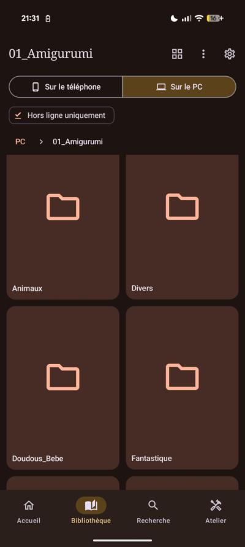

# 🧶 Mon Carnet Crochet

**L'appli pour lire tes tutos de crochet et suivre tes ouvrages, rang après rang. Sur Android et sur iPhone.**

Tes tutos (PDF, images, vidéos, textes) au même endroit, avec un compteur de rangs, des notes et ton stock de laine.

  <a href="#-android"><b>🤖 Android</b></a> &nbsp;·&nbsp; <a href="#-iphone"><b>🍏 iPhone et iPad</b></a>

Gratuite, sans compte et sans publicité.

  
  
  
  
  

---

## Ce que fait l'appli

### 📚 Tous tes tutos au même endroit
- PDF, images, vidéos et fiches texte.
- Depuis un dossier du téléphone et/ou **directement depuis le PC de la maison** par le Wi-Fi, sans rien copier.
- Vues grille, liste, cartes ou compacte, avec miniatures.
- Recherche par nom, **dans le texte des PDF**, dans tes notes ou tes étiquettes.

### 📖 Un lecteur pensé pour le crochet
- Reprend chaque tuto **à la dernière page lue**.
- **Annotations** : stylo, surligneur, texte. Le fichier d'origine n'est jamais modifié.
- Marque-pages, niveau de difficulté, étiquettes et notes avec cases à cocher.

### 🔢 Suivre un ouvrage
- **Compteur de rangs** affiché par-dessus le tuto, qu'on avance aussi avec les **boutons de volume**.
- **Règle de lecture** qui descend d'une ligne à chaque rang.
- **Mode mains libres** : dis « suivant » ou « précédent », les mains restent sur le crochet.

### 🧰 L'atelier
- Projets en cours.
- Stock de laine.
- Lexique des points **FR ↔ US ↔ UK**.
- Tailles de crochets.
- Calculatrices.

---

## 🤖 Android

### [⬇️ Télécharger la dernière version](https://github.com/Loroche974/crochetatelier-releases/releases/latest)

Android 8.0 ou plus récent, sur téléphone et tablette.

1. Sur le téléphone, ouvre la page **[Dernière version](https://github.com/Loroche974/crochetatelier-releases/releases/latest)**.
2. Touche le fichier `MonCarnetCrochet-….apk` pour le télécharger, puis ouvre-le.
3. Si Android le demande, autorise l'installation pour ton navigateur.

L'appli n'est pas sur le Play Store. Elle se **met à jour toute seule** : quand une nouvelle version sort, elle te la propose au démarrage. Tu peux aussi vérifier dans *Réglages › Vérifier les mises à jour*.

## 🍏 iPhone

### [📲 Ouvrir la version iPhone](https://loroche974.github.io/crochetatelier-releases/iphone/)

Sur iPhone et iPad, l'appli s'installe depuis **Safari**, sans passer par l'App Store :

1. Ouvre **[ce lien](https://loroche974.github.io/crochetatelier-releases/iphone/)** dans Safari (pas depuis Instagram ni un autre navigateur).
2. Touche le bouton **Partager** (le carré avec une flèche), puis **Sur l'écran d'accueil** › **Ajouter**.
3. Ouvre l'appli depuis sa nouvelle icône : elle s'affiche en plein écran et **marche sans Internet**.

Tu y retrouves les mêmes fonctions que sur Android : bibliothèque, recherche dans le texte des PDF, annotations, compteur de rangs, règle de lecture, mains libres, atelier, thème de Noël. Les tutos s'ajoutent depuis l'app **Fichiers** ou **iCloud Drive**.

Quelques différences, à cause de l'iPhone :
- pas de connexion au PC ni de boutons de volume pour compter ;
- la commande à la voix est expérimentale (le toucher marche toujours) ;
- quand un compteur atteint son objectif, l'appli sonne au lieu de vibrer.

Les mises à jour arrivent toutes seules quand l'iPhone a Internet : un bandeau « Nouvelle version » s'affiche, il suffit de le toucher.

> 💡 L'iPhone peut effacer les données d'un site peu utilisé. L'appli te rappelle de faire une sauvegarde toutes les deux semaines : garde-la dans Fichiers ou iCloud Drive.

## Tes données

Tout reste sur ton téléphone : aucun compte, aucun serveur, aucune publicité. La seule connexion à Internet sert à vérifier s'il existe une nouvelle version. Une sauvegarde de tes projets, notes, annotations et favoris s'exporte en un fichier `.zip` (*Réglages › Sauvegarde*). **Le même fichier se lit sur Android et sur iPhone** : de quoi passer ses projets d'un téléphone à l'autre.

---

© 2026 Loroche974 · Tous droits réservés. 
Appli créée pour <b>Co'Condemailles</b> 🧶

L'appli est gratuite, mais ni son code ni ses visuels ne peuvent être repris ou revendus sans autorisation.

